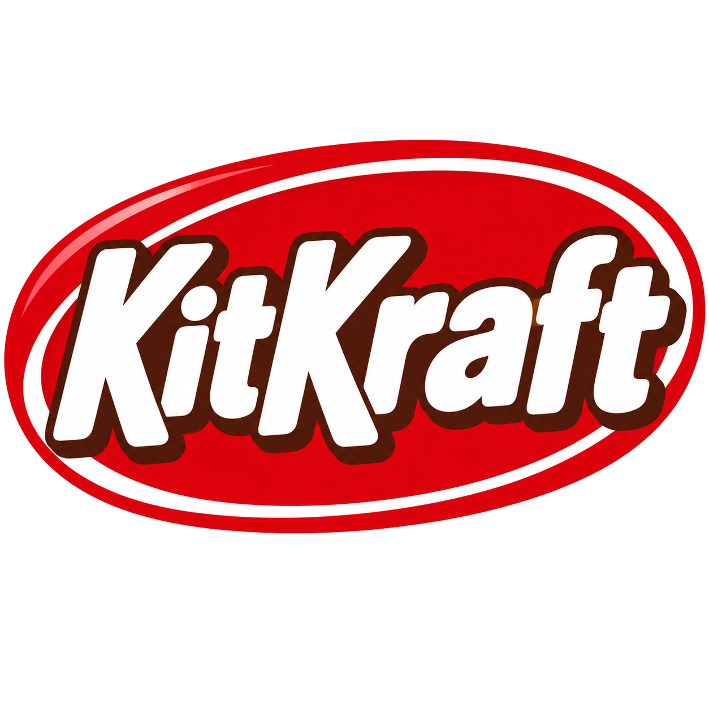

<!--
  1 SOFTWARE. DO NOT EAT.
  ABSOLUTELY NO RELATION TO ANYTHING EDIBLE, REAL OR FICTIONAL.
  Manufactured in a facility that also processes bugs.
  May contain traces of Papyrus.
-->
<p align="center">
  <br>
  <sub><sub><sub>Manufactured in a facility that also processes bugs. May contain traces of Papyrus.</sub></sub></sub>
</p>

<h1 align="center">KitKraft</h1>

<p align="center">
  <b>An open-source, clean-room Creation Kit for Starfield, written in Rust.</b><br>
  Read, inspect, patch and validate Starfield plugins, archives, Papyrus and string tables<br>
  from one command catalog you can drive from a terminal, a window, or an AI agent.
</p>

<p align="center">
  
  
  
  
  
</p>

<p align="center">
  <a href="#why-kitkraft">Why KitKraft</a> ·
  <a href="#what-it-has-done-so-far">So far</a> ·
  <a href="#get-started">Get started</a> ·
  <a href="#the-command-catalog">Commands</a> ·
  <a href="#built-for-agents">Agents</a> ·
  <a href="#build-from-source">Build</a> ·
  <a href="#clean-room">Clean room</a> ·
  <a href="#license">License</a>
</p>

<br>

<table>
  <tr>
    <td width="25%" valign="top">
      <h3>🔁 Byte-for-byte honest</h3>
      Every official Starfield ESM (all 14) loads and writes back byte-identical. If KitKraft opens your file, it can hand it back untouched.
    </td>
    <td width="25%" valign="top">
      <h3>🔎 Shows its work</h3>
      Every result carries its evidence: byte offsets, coverage and stated limitations. Unknown is reported as unknown, so you (or your agent) can check.
    </td>
    <td width="25%" valign="top">
      <h3>🧩 One catalog, three doors</h3>
      Each action is one command, the same from the <code>kit</code> CLI, the MCP server, and the workbench window. Learn it once.
    </td>
    <td width="25%" valign="top">
      <h3>🛡️ Plays nice with MO2</h3>
      Reads your Mod Organizer 2 profiles read-only, finds the game by itself, and only ever writes where you tell it to.
    </td>
  </tr>
</table>

<br>

## Why KitKraft

The Creation Kit is a big, Windows-only editor that does a lot and explains little. KitKraft
takes the parts modders reach for every day (looking things up, seeing who overrides what,
making a small patch, checking it before it breaks a save) and makes each one a single,
scriptable command that tells you exactly what it did and what it couldn't.

It reads and writes Starfield plugins (`.esm`/`.esp`/`.esl`), archives (`.ba2`), compiled
Papyrus (`.pex`) and string tables.

*Naming (owner, 2026-10-14): the name is KitKraft; identifiers are `kitkraft-*`,
`KITKRAFT_*`, `kitkraft://` (the binary stays `kit`). The pre-rename `KITCRAFT_*`
environment variables and `kitcraft-manifest.json` are still read for one release
(deprecated; [docs/corpus.md](docs/corpus.md), "Environment").*

## What it has done so far

Real mods, built by KitKraft, checked in the real game:

- ✅ **A rename patch.** The Old Earth Hunting Rifle became the Old Soviet Marksman Rifle in a
  plugin KitKraft wrote, and it showed up that way in game (M2.O6, PASS).
- ✅ **A gun overhaul.** A data-driven overhaul compiled from a TOML brief, every row checked
  with `player.additem` on a clean profile (M3.O5, PASS).
- ✅ **A first point of interest.** A placed crate in New Atlantis, reached and clicked in game
  (M4.O2, PASS).
- 🧰 **Every catalog command is live:** load orders from MO2 profiles, inspect, query, diff,
  conflicts, set, build, validate, schema, archives, Papyrus and string tables. What a command
  doesn't do yet is written in each result's `limitations` and in [docs/gaps.md](docs/gaps.md).
- 🪟 **A read-only workbench** (`kit ui`) with Start, Ledger and Help tabs over the same
  commands ([docs/workbench.md](docs/workbench.md)).

Where it's headed: [ROADMAP.md](ROADMAP.md). What's happening right now:
[plan/STATUS.md](plan/STATUS.md).

## Get started

**The easy way (the dev box):** read [docs/QUICKSTART.md](docs/QUICKSTART.md).
`cargo xtask dist` builds a folder of double-click files (workbench, shell, validate, deploy
to the dev profile, install/uninstall), and `Install.cmd` puts `kit` on your PATH and
registers the MCP server. No environment variables needed.

KitKraft finds the game (Steam's registry and libraries) and MO2
(`C:\Modding\MO2-Starfield`) on its own; `kit doctor` tells you what it found and how. For
every command: argument > environment variable > detected.

**Your first ten minutes:**

```powershell
cargo xtask dist                          # dist\KitKraft\kit.exe, kit-ui.exe and the .cmd files
kit doctor                                # what was found, each line OK or a fix

# Load an MO2 profile (read-only) and look around; a bare name is a profile of the detected MO2
kit load  --profile "KitKraft Dev"
kit query --type WEAP --where "FULL ~ 'Old Earth Hunting Rifle'" --profile "KitKraft Dev"
kit schema --type WEAP                    # what the schema knows about a record type

# Write a patch: rename the rifle into a new plugin, then check it
kit set Starfield.esm:0021BBCD FULL="Old Soviet Marksman Rifle" --into out\OldSovietMarksmanRifle.esm --plugins Starfield.esm
kit validate --plugin out\OldSovietMarksmanRifle.esm

# Or just look at it
kit ui --dev
```

Each `kit` run is its own session, so commands that need a load order take `--profile` or
`--plugins` each time; an MCP session loads once and keeps it. Lost? `kit help` lists every
command, `kit help <command>` its arguments, and `--json` prints the full result envelope
(data, coverage, limitations, byte-offset evidence).

> [!TIP]
> Test in-game changes on a dedicated MO2 profile (ours is **KitKraft Dev**) and a
> disposable save. KitKraft never writes into your profiles; `kit deploy --dev` writes only
> into one isolated, KitKraft-managed mod.

## The command catalog

Each line is a CLI subcommand, an MCP-reachable command, and a future menu item.

```
kit load  --profile "C:\Modding\MO2-Starfield\profiles\Default"   # or --plugins A.esm B.esp
kit inspect <FormID|EditorID> --profile ...   # every override, the winner, typed values
kit query  --type WEAP --where "EDID ~ 'Rifle'"
kit conflicts --master Starfield.esm          # which plugins override what (esmscan.py port)
kit set    <form> FULL="Old Soviet Marksman Rifle" --into MyPatch.esm
kit diff   A.esm B.esm [--form ...]           # record-level diff with byte ranges
kit build  overhaul.toml <out.esm>            # data-driven patch compiler, validated
kit validate --plugin <plugin>                # missing masters, bad links, localized FULL
                                              #   copies, stripped FULL/NTRM, god-mode calls
kit schema --type WEAP [--deep]               # members, types, sources, confidence
kit coverage <plugin>                         # record types vs what the schema defines
kit roundtrip <esm> --verify                  # byte-identical rewrite, the M1 gate
kit ba2 {list,extract,pack}
kit papyrus {disasm,compile}                  # wraps Bethesda's compiler; never -release
kit strings {dump,merge}
kit doctor [--get data_dir|mo2|dev_profile|...] # what is detected here; each line OK or a fix
kit mcp [--profile DIR]                       # stdio MCP server over the same catalog
kit ui [--dev]                                # the read-only workbench
kit install | uninstall [--apply]             # PATH + MCP registration (CLI only; dry run by default)
```

## Built for agents

Point an agent at KitKraft and it gets the same catalog you do, with the same evidence
attached. `kit mcp` serves it over stdio to Claude Code or any other MCP client
([docs/mcp.md](docs/mcp.md), "Use from Claude Code").

```powershell
kit mcp --profile "C:\Modding\MO2-Starfield\profiles\Default"
```

- **Tools:** `execute` (any command), `command_line`, and the shortcuts `inspect_record`,
  `query_records`, `diff_plugins`, `coverage`, `record_schema`, `roundtrip`.
- **Resources:** `kitkraft://commands`, `kitkraft://load-order`, `kitkraft://validate-rules`.

The goal is that someone can point an agent at this project, say "I want a mod that does X",
and the tooling carries it end to end, checking its own work along the way.

## Build from source

Requires a stable Rust toolchain (`rustup`; `rust-toolchain.toml` selects stable with
rustfmt and clippy).

```powershell
cargo build --workspace
cargo run -p kit-cli -- help
cargo xtask ci        # the gate: layer check, fmt, clippy -D warnings, tests
git config core.hooksPath .githooks   # once per clone: pre-commit runs layers + fmt check
```

Corpus tests read your own game install through `KITKRAFT_DATA_DIR` (set it for them; they
do not use detection) and are skipped without it; see [docs/corpus.md](docs/corpus.md).

```
crates/   schema esm ba2 pex strings nif (L0)  doc (L1)  io (L3)  engine (L4)  mcp (L5)
apps/     kit-cli (kit), kit (kit-ui, the workbench)
xtask/    cargo xtask ci | layers | codegen | parity | dist
plan/     STATUS.md, execution-plan.md, adr/
docs/     architecture, mcp, parity checklists, gaps, corpus
corpus/   README only; the corpus lives in your game install
```

New contributors and AI agents: start with [AGENTS.md](AGENTS.md).

## Clean room

Formats are implemented from the shared container described on UESP's (Skyrim) wiki pages,
Starfield record definitions informed by xEdit's MPL-2.0 `wbDefinitionsSF1.pas` (and the
helpers it uses in `wbDefinitionsCommon.pas`) at one pinned revision (used as reference only: our definitions are written independently and no xEdit
code is copied or linked), and validated by our own inspection of files we own and
black-box observation of the Creation Kit's saved output; the hierarchy is in
[ADR 0005](plan/adr/0005-spec-sources-per-fact.md) (Amendment 2) and
[ADR 0004](plan/adr/0004-xedit-source-policy.md). The Creation Kit is observed as a black
box only. No GPL Bethesda-format code (Mutagen, Spriggit) is read. No Bethesda data ships
in this repository.

## Policies (owner, 2026-10-14)

- **Runtime extensions** ([ADR 0008](plan/adr/0008-runtime-extensions.md)): SFSE and similar
  frameworks are supported where technically justified, behind their own boundary; the
  core crates never depend on them, and SFSE binaries are never bundled.
- **Development deployment** ([ADR 0009](plan/adr/0009-dev-deployment.md)): `package` stays
  target-independent; only an explicit `kit deploy --dev` writes into MO2, into one
  isolated KitKraft-managed mod, never into profiles or other mods.
- **Developer workbench** ([ADR 0007](plan/adr/0007-egui-shell-over-the-catalog.md),
  Amendment 1): a read-only egui workbench over the same commands as the CLI comes once
  the inspection APIs are stable; the full authoring UI is M5.

> [!IMPORTANT]
> **Status: pre-alpha.** KitKraft has built real, working mods and checked them in game, but
> it is not a Creation Kit replacement yet: authoring is command-line first, the workbench
> is read-only, and record layouts are still being filled in. Back up your saves, use a
> separate profile, and read each result's `limitations`.

## License

Licensed under either of

- Apache License, Version 2.0 ([LICENSE-APACHE](LICENSE-APACHE))
- MIT license ([LICENSE-MIT](LICENSE-MIT))

at your option. Unless you explicitly state otherwise, any contribution intentionally
submitted for inclusion in this work, as defined in the Apache-2.0 license, shall be dual
licensed as above, without any additional terms or conditions.

Not affiliated with or endorsed by Bethesda Softworks, ZeniMax Media, or Microsoft. See
[NOTICE](NOTICE).

<br>

<p align="center">
  
</p>

<p align="center">
  <sub>
    <b>Full disclosure:</b> no human has reviewed the code in this repository. A human directed
    it, set the goals, made the calls and checked the results in the actual game; AI agents
    wrote it. The tests, the byte-identical round trips and the evidence on every result are
    how we keep each other honest. Read accordingly, and have fun.
  </sub>
</p>
