> **Owner decision (M6.O1, 2026-10-16): Workbench.** Owner: "Workbench, themes look great only keep the mocks if there's a good reason." The twelve screenshots were moved out of the repository to the ignored folder out/mockups/2026-10-16/ (the plan's rule: tour images stay outside git); regenerate them with the screenshot tour (docs/workbench.md) if needed. The token table below remains the record of the two directions.

# Workbench mockups for M6.O1: Workbench or Studio (2026-10-16)

Two directions for the workbench's look, each the same window with a different token
preset (`docs/design/workbench-visual-system.md`). Pick one, or a mix named per token
group (type, spacing, radii, density, palette), and record it as M6.O1.

- **Workbench**: neutral graphite and cool grey, dense, an instrument panel. 13 pt body,
  20 pt zebra rows, square corners, one steel-blue accent; designed dark first.
- **Studio**: warm paper and umber, more air, stronger hierarchy. 14 pt body, 22 pt
  headings, 28 pt rows without zebra, rounded corners, a terracotta accent; designed
  light first.

These are real screenshots, not drawings: the release `kit-ui` with the screenshot tour
(`docs/workbench.md`, "Screenshot tour"), read-only, on the KitKraft Dev profile, at 100
percent Windows scaling, window 1400 x 1100, Segoe UI and Consolas. Data is whatever the
profile held on 2026-10-16.

```text
$env:KITKRAFT_WORKBENCH_SHOTS = '<a folder outside the repo>'
kit-ui --profile "C:\Modding\MO2-Starfield\profiles\Kitkraft Dev" --theme workbench-dark
```

Run `kit ui --theme workbench` or `kit ui --theme studio` to try either live (`-light`
or `-dark` fixes the mode). Without `--theme` the window keeps today's look (`classic`).

## Start

The Start tab names the preset and shows the five statuses (pass, fail, warning, not-run,
inconclusive) as glyph, word and color.

| | Workbench | Studio |
| - | - | - |
| Light | 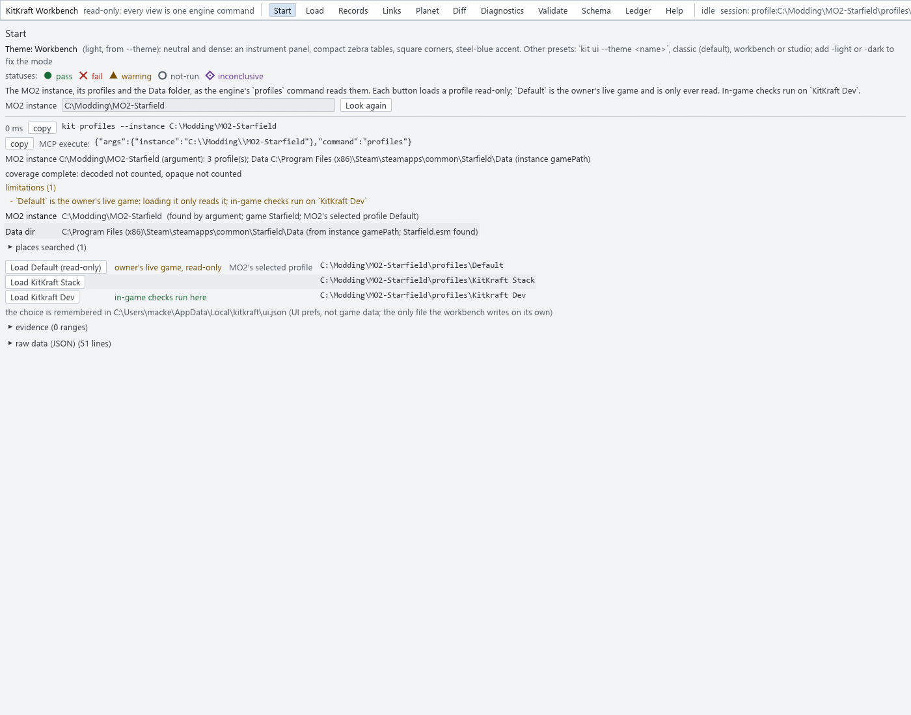 | 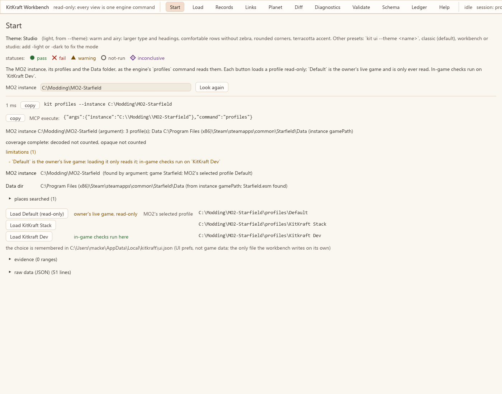 |
| Dark | 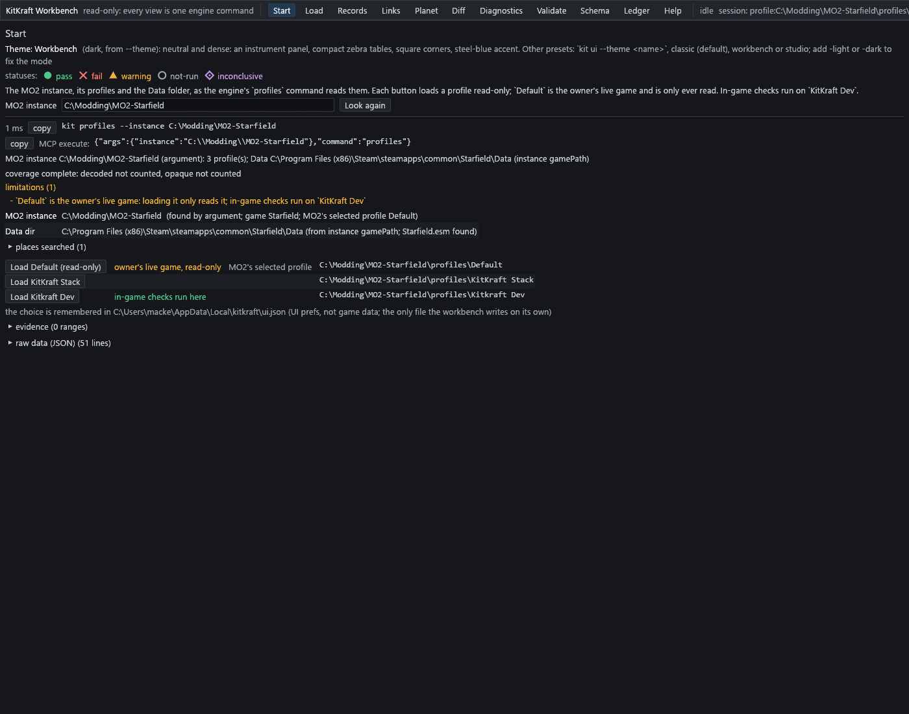 | 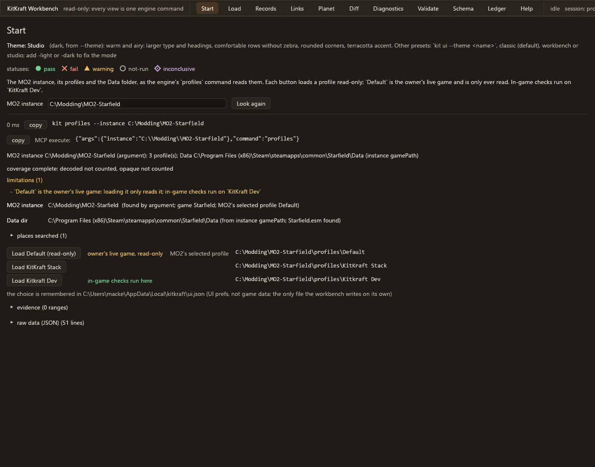 |

## Records: query table, selected record, inspector

`query WEAP where FULL ~ 'Rifle'`, then `inspect` on the first match. The tour scrolls to
the table so it and the inspector share the image.

| | Workbench | Studio |
| - | - | - |
| Light | 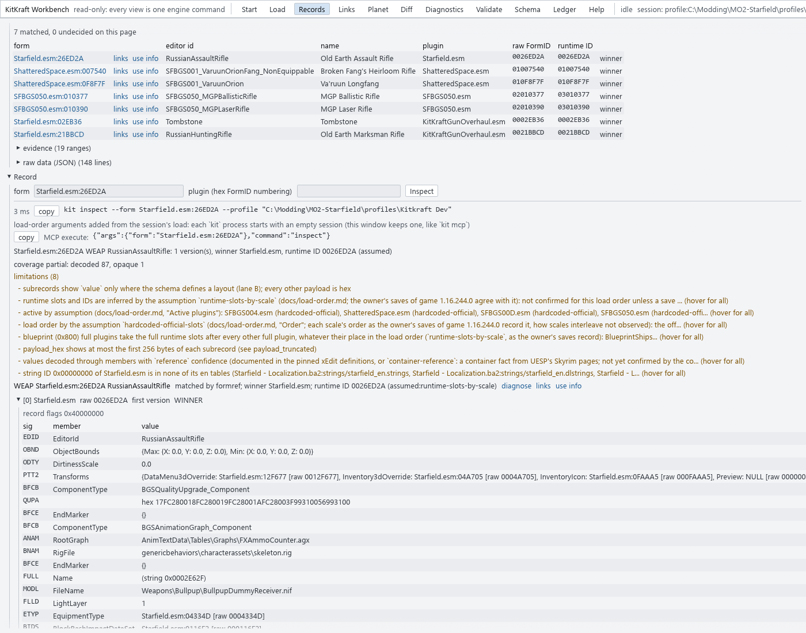 | 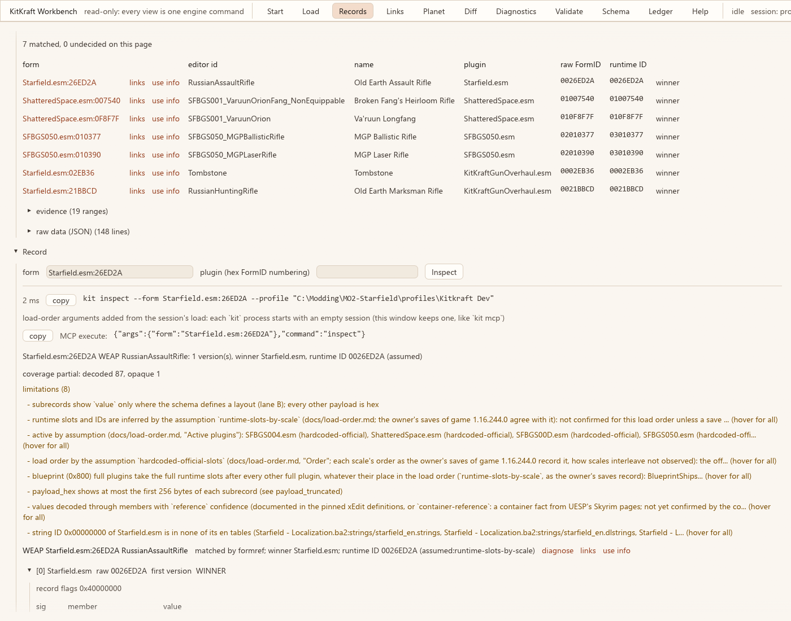 |
| Dark | 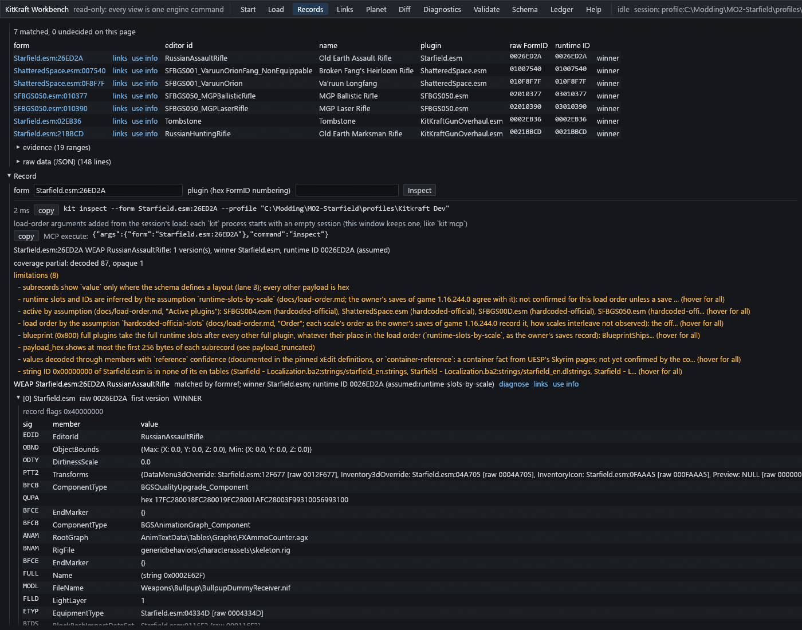 | 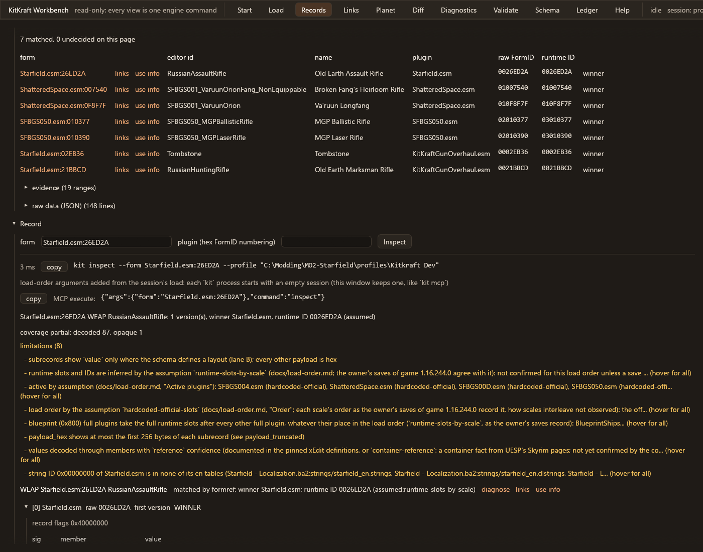 |

## Validate: status rows

`validate` on the biggest plugin the profile activates (`KitKraftGunOverhaul.esm`, which
passed every rule that day, so only `PASS` rows show here; the Start images show all five
statuses).

| | Workbench | Studio |
| - | - | - |
| Light | 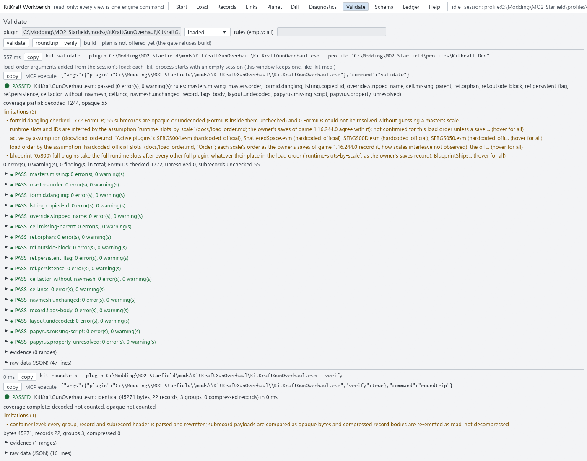 | 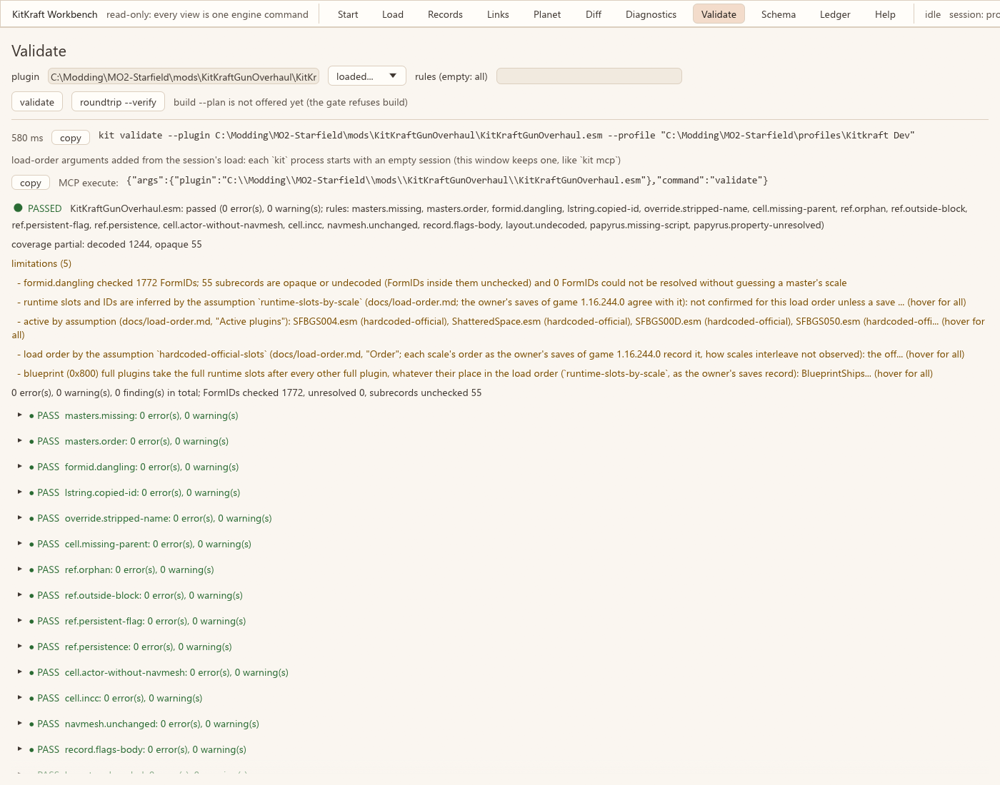 |
| Dark | 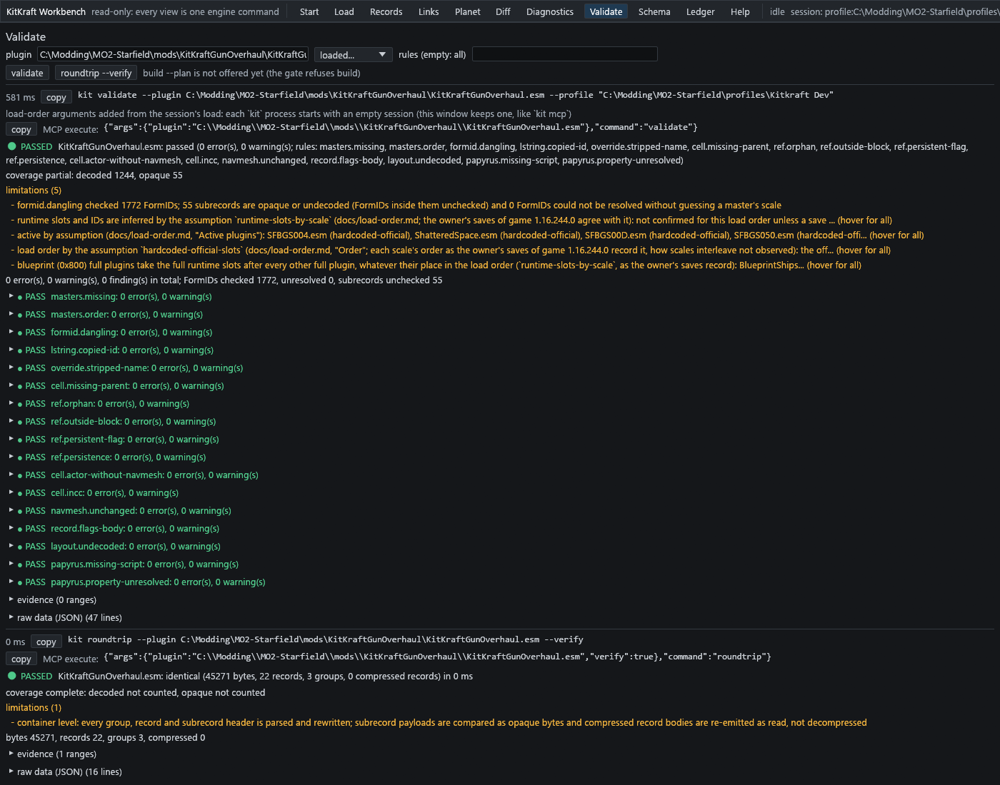 | 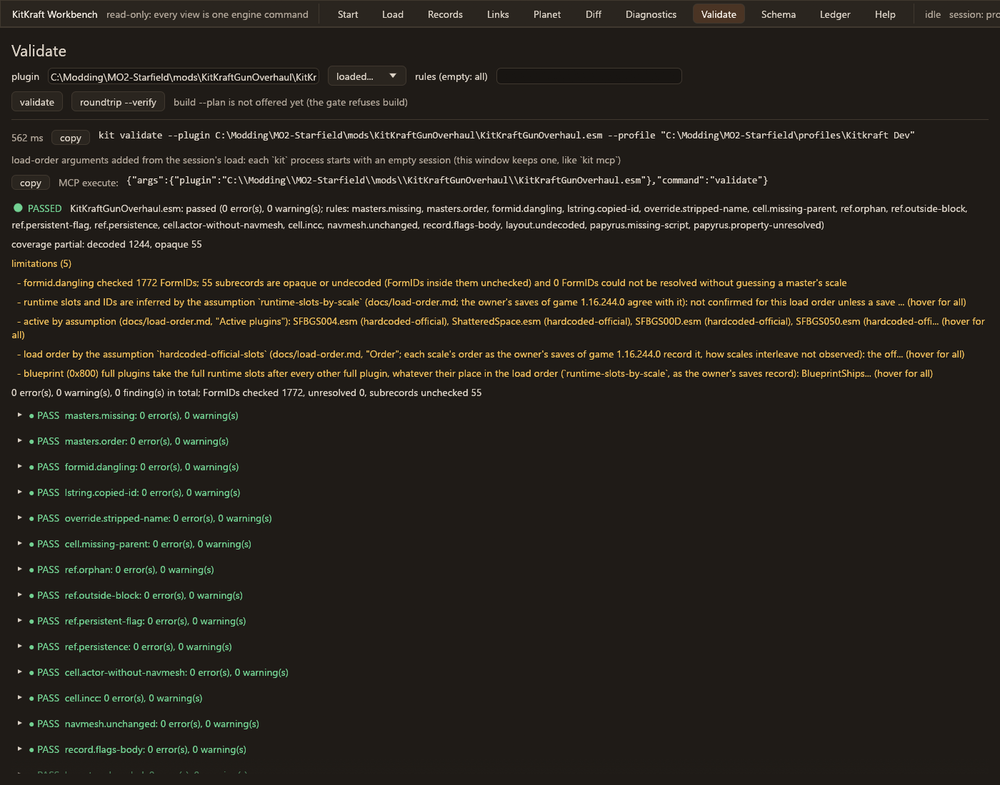 |

## The tokens that differ

Everything else (fonts, the status glyphs and words, the AA contrast rule) is the same in
both.

| Token group | Token | Workbench | Studio |
| ----------- | ----- | --------- | ------ |
| Type (pt) | small / body / mono / heading | 11 / 13 / 12.5 / 16 | 12 / 14 / 13.5 / 22 |
| Spacing (pt) | item gap x / y | 8 / 4 | 12 / 8 |
| | button padding x / y | 8 / 2 | 12 / 4 |
| | panel margin / indent | 8 / 16 | 16 / 24 |
| Radii (pt) | control / panel | 2 / 4 | 6 / 8 |
| Density | name | compact | comfortable |
| | row height / cell gap x / cell gap y | 20 / 12 / 2 | 28 / 16 / 4 |
| | zebra rows | on | off |
| Palette, light | base / raised / sunken | `#f3f4f6` / `#ffffff` / `#e9ebee` | `#faf6f0` / `#fffdf9` / `#f1eadf` |
| | text strong / body / muted | `#111417` / `#30363d` / `#4f5862` | `#231e1a` / `#3f3731` / `#5c5249` |
| | accent / selection | `#1d5c94` / `#d3e3f3` | `#963f1f` / `#f3dccb` |
| | pass / fail / warning | `#1a6b37` / `#b42318` / `#7a5000` | `#2a6b33` / `#a8261a` / `#7a4d00` |
| Palette, dark | base / raised / sunken | `#15171a` / `#22262b` / `#0f1113` | `#1f1b17` / `#2a251f` / `#181512` |
| | text strong / body / muted | `#f0f2f4` / `#c9ced4` / `#9aa3ad` | `#f7f1e9` / `#dcd3c7` / `#b0a598` |
| | accent / selection | `#6cb4ee` / `#1f3a52` | `#eba571` / `#4a3424` |
| | pass / fail / warning | `#4fc98a` / `#ff7a70` / `#f2b33d` | `#72d192` / `#ff8f80` / `#f0bf5a` |

## What to look at

- **Density.** Workbench shows the whole query table and about 15 inspector rows at once;
  Studio shows the table, but its inspector starts at the bottom of the image (a row every
  32 pt against 22). Studio reads more calmly, Workbench shows more.
- **Top bar.** At 1400 points Studio's wider tabs push the session line off the right
  edge ("session: pro..."). M6.V5's panel frame would wrap or shorten it; today neither
  preset does.
- **Hierarchy.** Studio's 22 pt headings and 16 pt margins separate sections; Workbench
  relies on zebra rows and rules.
- **What is not themed yet.** Both keep today's layout, the long limitation lines and the
  envelope header as they are; one panel frame and table style for every tab is M6.V5,
  after this choice.

Total size of the 12 images: 3.6 MB.
