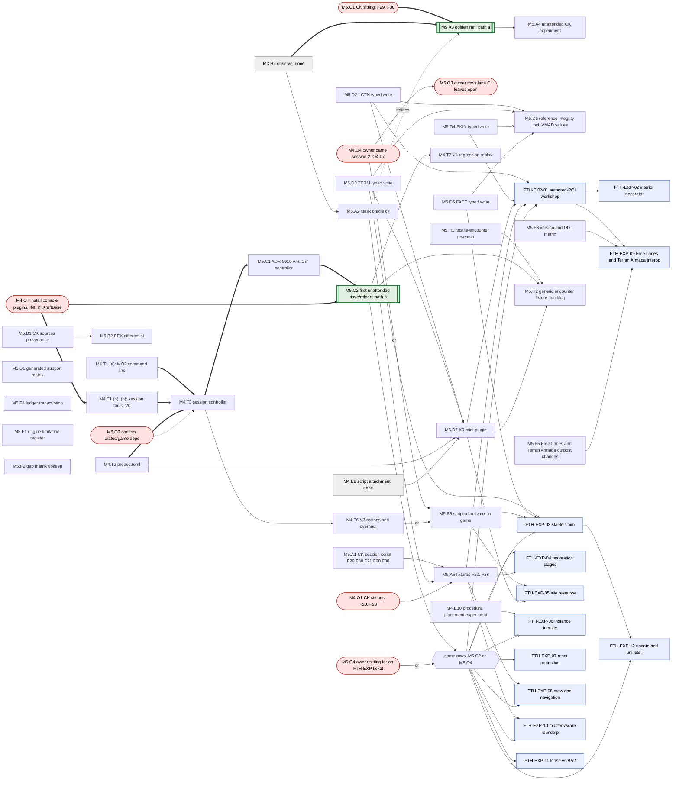

# M5 dependency graph

The tickets of M5 (`plan/execution-plan.md`, "M5") and the owner actions they wait on.
A plain arrow means "must finish first". An arrow labelled `or` is one of two routes, either
of which is enough (the hexagon gathers them); a dotted arrow labelled `refines` improves a
ticket after it has run, without blocking it. Owner actions are the rounded red nodes; the
two targets of "the shortest validated path" are the double-bordered nodes, and the path's
edges are thick. M4 tasks that M5 builds on are named with their M4 ids. Update this file
in the commit that changes a ticket's dependencies.

Tickets with no incoming edge start now: M5.A1, M5.A2 (its only dependency is done),
M5.B1, M4.T1 (a), M4.T2, M5.D1 to M5.D5, M5.F1 to M5.F5, M5.H1
(`docs/foothold/next-sprint.md`), and the owner's M5.O1. The dotted edge M5.O2 -> M4.T3
blocks the merge only if a dependency's license is not MIT or Apache-2.0 (ADR 0010
Amendment 1 (c)). M5.B3 takes either M4.O4 (owner) or M4.T6 (lane C); every FTH-EXP game
row takes either M5.C2 (controller) or M5.O4 (an owner-assisted sitting from the ticket's
testplan), so an experiment can run before the automation lands.

## Shortest validated path

From `main` at `fcb443a`; owner actions in bold (`plan/execution-plan.md`, "The shortest
validated path").

(a) A CK-authored golden fixture round-trips through KitKraft with a clean differential:

1. **M5.O1**: the owner-assisted CK sitting for F29 and F30. It can start now:
   `plan/STATUS.md` "Owner next actions" row 12 already holds the steps. M5.A1 (session
   script) and M5.A2 (`cargo xtask oracle ck`) run in parallel, off the path.
2. M5.A3: the golden run with the tools that exist (`cargo xtask observe`, `kit roundtrip
   --verify --decode`, `validate`, `kit diff`), differences classed in the ledger entry;
   M5.A2 reruns it when it lands.

(b) One unattended game session records a save/reload result:

1. **M4.O7**: the owner installs the console plugins, sets the INI switches and makes
   `KitKraftBase`. In parallel, agents: M4.T1 (a) (the MO2 command line; needs no
   M4.O7), M4.T2, and M4.T3 + M5.C1's parts that need no game.
2. M4.T1 (b)..(h): session facts and V0.
3. M4.T3 + M5.C1 completed; **M5.O2** at the merge.
4. M5.C2: the first unattended save/reload row (O2-08).
